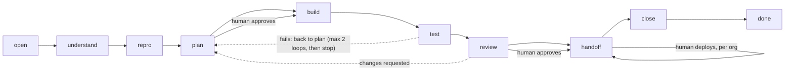

# Orgtomo

A team of Claude Code agents that takes a Salesforce ticket from "what is being asked" to a verified deploy pack, with proof at every step.

[](https://github.com/khadda-ai/orgtomo/actions/workflows/ci.yml)
[](LICENSE)

*Org* + *tomo* (友, Japanese for friend, companion).

## What it is

Orgtomo runs inside [Claude Code](https://code.claude.com/docs). You give it a ticket key. A lead agent hands the work to specialists, one stage at a time, and an engine decides after each stage whether the result is good enough to continue.

It is built for Salesforce developers, admins and consultants who already do this work with an AI assistant by hand: paste the ticket, ask for an explanation, ask for a reproduction, ask for a plan, build, test, write the update. Orgtomo makes that sequence a system, and adds the parts that are easy to skip when doing it by hand.

**Nothing is guessed.** Every claim an agent makes must cite evidence that the engine itself recorded: a query result, a test run, a deploy, a fresh fact from the org map, or a sentence from official Salesforce documentation. Wording such as "probably" fails a gate.

**The Lead does not trust reports.** After a stage passes its gates, the Lead re-runs the proof of one claim and compares.

**Production is read-only.** Reads are masked. There is no setting that changes this.

**Humans deploy.** Agents build and test in your dev sandbox. For every other org, Orgtomo prepares a deploy pack for your tool (Blue Canvas, change sets, Git and the CLI, or a generic checklist), waits for you, then checks that the org matches what was built.

**Test data is safe.** Only the e-mail addresses and phone numbers you allow may appear in test records, scripts, browser input and drafts. In the default mode, agents write data only while the sandbox cannot send e-mail.

**It learns from what really happened.** Failed gates, rejected plans, reviewer findings and your own feedback are recorded as observations. Lessons must cite them. Approved lessons are loaded by the agent they concern.

## The team

| Agent | Role |
|---|---|
| Tomo Lead | Architect and manager. Delegates, verifies, reports. Never builds. |
| Analyst | Business analyst, functional consultant and product owner: plain and technical understanding, acceptance criteria, examples. |
| Reproducer | Proves a bug with data in a sandbox. Never by reading code. |
| Planner | Smallest correct design, grounded in the org map and official documentation. |
| Builder | Implements the approved plan in the build org: backup first, your naming and comment style. |
| Tester | Tests every criterion with proof, reruns the reproduction, bulk and regression. |
| Reviewer | Independent review against a rubric, on a different model from the Builder. |
| Cartographer, Baseline, Scribe, Coach, Notetaker | Org map, before-state, message drafts, lessons, meeting notes. Optional ones have a switch. |

## How a ticket moves



Stages, gates and contracts are data (`spec/stages.yaml`, `spec/gates.yaml`, `spec/schemas/`). The engine interprets them.

## Requirements

- Claude Code
- Node.js 20 or newer
- Salesforce CLI (`sf`), logged in to each org under an alias
- Optional: [Obsidian](https://obsidian.md) to browse the vault (the control panel shows the org map too); a tracker connector (Atlassian by default); the Playwright MCP server for browser steps

Orgtomo has no runtime dependencies to install. The one third-party library it uses is vendored.

## Quick start

```bash
npm install -g github:khadda-ai/orgtomo

mkdir my-company && cd my-company
orgtomo setup            # asks for your orgs, deploy tools and allowed test data
orgtomo doctor --orgs    # checks the CLI, each org, and whether it is really a sandbox

orgtomo brain sync uat   # build the org map
orgtomo discover run uat --retrieve   # optional: study how the business uses the org
orgtomo ui               # review agents, safety and features, browse the org map
```

Install the three plugins for this folder only, so that they load here and nowhere else:

```bash
claude plugin marketplace add khadda-ai/orgtomo
claude plugin install orgtomo@orgtomo --scope project
claude plugin install salesforce-development@orgtomo --scope project
claude plugin install salesforce-code-quality@orgtomo --scope project
```

Then start a session with the Lead and give it a ticket:

```bash
orgtomo start
```

```
/orgtomo:ping
/orgtomo:ticket ABC-123
```

Full walkthrough: [docs/SETUP.md](docs/SETUP.md).

## What you type

| You type | What happens |
|---|---|
| `/orgtomo:ticket ABC-123` | The team starts or continues the ticket |
| `/orgtomo:approve` / `/orgtomo:reject <reason>` | Your decision at a gate |
| `/orgtomo:answer Q1 <text>` | Answer a blocking question |
| `/orgtomo:deployed uat` | You finished a deploy; parity check and retest follow |
| `/orgtomo:feedback bad planner <what you saw>` | Recorded as evidence for lessons |
| `/orgtomo:rule builder <rule>` | A rule in your words; applies at once |
| `/orgtomo:models planner opus xhigh` | Model and effort per agent |
| `/orgtomo:restore ABC-123` | Put the backed-up versions back into the build org |
| `/orgtomo:status`, `/orgtomo:lessons`, `/orgtomo:brain`, `/orgtomo:doctor` | Look around |

All commands: [docs/COMMANDS.md](docs/COMMANDS.md).

## Configuration

Everything about your setup lives in `orgtomo.config/` in your workspace. Agents cannot write there.

| File | Holds |
|---|---|
| `orgs.yaml` | Your orgs, their CLI aliases and roles (build, test, reference, production) |
| `pipeline.yaml` | Build org, deploy targets and tools, loop limit, autonomy, lite path |
| `safety.yaml` | E-mail mode, allowed test addresses and numbers, masking, browser rules |
| `agents.yaml` | Model, effort and on/off per agent |
| `features.yaml` | Lite path, self-learning, meetings, people profiles, Flow generator, telemetry |
| `conventions.yaml` | Your naming, comment and format rules, and forbidden patterns |
| `capabilities.yaml` | Which tool provides which capability; add your own MCP servers here |

Change them in the files, in the control panel (`orgtomo ui`), or with the slash commands. Details: [docs/CONFIGURATION.md](docs/CONFIGURATION.md).

## The vault

Knowledge is kept as Markdown in `vault/`, which opens as an Obsidian vault:

- `orgs/<org>/`: the org map. One generated note per component with what it uses and what uses it, a hub page per object, a "what runs on this object" note in save order, and a canvas map.
- `orgs/<org>/business/`: how the business uses the org (optional). Areas and their objects, one process note per area with a fact behind every statement, and the questions only a person can answer.
- `tickets/<KEY>/`: every stage output, gate report, evidence and deploy pack.
- `learning/`: observations and lessons.
- `meetings/`, `people/`: optional features.

## Built on

- [forcedotcom/sf-skills](https://github.com/forcedotcom/sf-skills) (Apache-2.0) for Salesforce skills, the Apex and SOQL language server and Code Analyzer. Orgtomo installs it as separate plugins pinned to one commit (`sf-skills.lock`); nothing from it is copied into this repository.
- The Salesforce CLI for all org access.
- [Playwright MCP](https://github.com/microsoft/playwright-mcp) for browser steps (optional).

## Status

Version 0.2.0. Every released version keeps its own branch (`release/v0.1.0`, `release/v0.2.0`), so any of them can be installed by name. The engine, guards and gates are covered by an offline test suite that includes a complete ticket and adversarial cases. What has and has not yet been exercised against live orgs and a live Claude Code session is listed plainly in [docs/VERIFICATION.md](docs/VERIFICATION.md). Read it before relying on Orgtomo for real work.

## Documentation

- [Setup](docs/SETUP.md)
- [Architecture](docs/ARCHITECTURE.md)
- [Safety model and its limits](docs/SAFETY.md)
- [Agents](docs/AGENTS.md)
- [Knowledge: org map, learning, meetings, people](docs/KNOWLEDGE.md)
- [Configuration](docs/CONFIGURATION.md)
- [Commands](docs/COMMANDS.md)
- [Verification status](docs/VERIFICATION.md)

## Contributing

See [CONTRIBUTING.md](CONTRIBUTING.md). Pull requests target `develop`.

## Security

See [SECURITY.md](SECURITY.md) for how to report a vulnerability, and [docs/SAFETY.md](docs/SAFETY.md) for what the guards do and do not protect against.

## License

MIT. Copyright (c) 2026 Khadda AI Labs. See [LICENSE](LICENSE) and [NOTICE](NOTICE).
