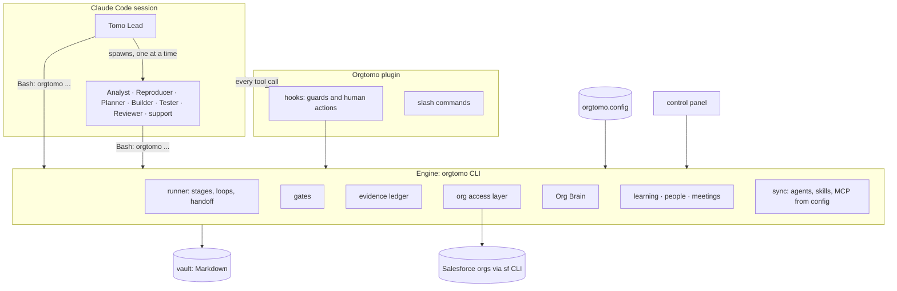

# Architecture

## Design rules

1. **Stages, gates and contracts are data.** The ticket lifecycle is `spec/stages.yaml`; the gate catalogue is `spec/gates.yaml`; every agent output has a JSON Schema in `spec/schemas/`. The engine interprets them. A workspace may override the stage machine and the review rubric.
2. **Capability first.** Agents ask for a capability (`tracker.read`, `browser.ui`, `meetings.read`). `capabilities.yaml` says which tool provides it. Swapping Jira for another tracker, or adding your own MCP server, is a configuration change.
3. **MCP first, not MCP only.** Trackers, browser and meetings come through MCP. Org access goes through the Salesforce CLI, because that is where Salesforce's own tooling is today, wrapped by one access layer that holds the org rules.
4. **The engine records evidence; agents cite it.** An agent cannot create evidence by writing a file.
5. **Humans own decisions and deploys.** Approvals, rejections, answers and "I deployed" are recorded by the engine from the human's own action, never performed by a model.
6. **Fail closed.** An unknown Salesforce CLI command, an unlisted MCP tool, an unparseable command line, a guard that crashes: all denied.
7. **Everything a human needs to read is Markdown in one vault.**

## Building blocks



| Block | Where | Job |
|---|---|---|
| Runner | `engine/lib/ticket.js` | Ticket state, `next`, `submit`, Lead verification, loops, escalation, handoff, human actions |
| Gates | `engine/lib/gates.js` | Twenty-five checks that read contracts, evidence, source files and the Brain index |
| Evidence | `engine/lib/evidence.js` | Append-only ledger per ticket |
| Org access | `engine/lib/org.js` | Query (masked), retrieve, backup, deploy, Apex, tests, canary, parity, sandbox check |
| Guards | `engine/lib/guards/` | Shell policy, write guard, data guard, MCP guard |
| Hook entry | `engine/lib/hook.js` | One handler for all hook events |
| Org Brain | `engine/lib/brain.js` | Parse source, write fact notes, hub pages, index, canvas, drift, context packs |
| Discovery | `engine/lib/discover.js` | Areas, area pages and questions from the Brain; checks the Cartographer's process notes |
| Pages | `engine/lib/pages.js` | Builds the human-readable page of a stage from its contract |
| Models | `engine/lib/models.js` | Model catalogue: aliases, versions, effort levels per model |
| Knowledge | `learning.js`, `people.js`, `meetings.js` | Observations and lessons, reader profiles, meeting notes |
| Deploy packs | `engine/lib/deploypack.js` | Package, instructions per tool, checklist |
| Sync | `engine/lib/sync.js` | Generates `.claude/agents`, `.claude/skills`, `.claude/settings.json`, `.mcp.json` |
| Control panel | `engine/lib/ui-server.js`, `engine/ui/` | Local web UI for the human |

The engine is plain Node.js (ES modules, JSDoc types) with no build step and no runtime dependencies beyond one vendored YAML library.

## Why agents are generated into the workspace

Claude Code ignores `hooks`, `mcpServers` and `permissionMode` on agents that ship inside a plugin, and an agent's `skills` list refers to project skills by name. Orgtomo therefore ships agent **templates** (`agents-src/`) and playbooks (`skills-src/`), and `orgtomo sync` writes the real agent and skill files into the workspace's `.claude/` folder using your configuration: model, effort, tools from capabilities, your style rules, approved lessons. The plugin itself carries what must be global to the session: hooks, slash commands and the `orgtomo` command.

## A stage, step by step

1. The Lead runs `orgtomo next KEY`. The engine answers with the agent to spawn, the input files, the mode and the submit command.
2. The Lead spawns that agent. A `PreToolUse` hook on the spawn checks with the engine that it is this agent's turn for this ticket.
3. The agent works. Every Bash, write and MCP call passes the guards. Engine commands are rewritten by the hook to carry the caller's identity.
4. The agent writes `NN-name.md` and `NN-name.json` and runs `orgtomo submit KEY stage`. A `SubagentStop` hook refuses to let it finish without submitting.
5. The engine runs the stage's gates and writes `verify-<stage>.md`. Failures are recorded as observations for learning.
6. If the stage asks for it, the Lead re-checks one claim (`orgtomo verify`) with evidence it produced itself, after the submission.
7. If the stage needs approval, the ticket waits. The human's `/orgtomo:approve` is caught by a prompt hook and recorded by the engine.
8. The engine advances, loops back, or stops.

## Outcomes of a submission

| Outcome | What the engine does |
|---|---|
| Gates pass | Lead check (if required), approval (if required), next stage |
| Gates fail | Same agent fixes exactly the listed points; after `attempts.max` failures the ticket stops |
| A gate needs the human (blocking question, bug not reproduced) | Ticket waits for `/orgtomo:answer`; not counted as a mistake |
| Output is valid and says "tests failed" or "changes needed" | Loop back to plan; after `loop.max` loops (hard cap 3) the ticket stops with `escalation.md` |
| Lead finds a mismatch | Stage fails; recorded as a mistake of the owning agent |
| A tool, a login or an org is broken | The ticket is `blocked` with the reason (`orgtomo block`, or the engine after the same command fails twice). Not an attempt, not a mistake; the human resumes it. |

## Hooks used

| Event | Use |
|---|---|
| `SessionStart` | Banner: open tickets (with the reason when one is blocked), orgs, rules, meetings reminder |
| `UserPromptExpansion`, `UserPromptSubmit` | Human-only commands are executed here by the engine. Both are handled because either may deliver a slash command; the action is applied once per prompt. |
| `PreToolUse` | Bash policy (file ownership for shell writes included), write and data guards, MCP guard, sign-in of the agent browser, documentation hosts for WebFetch, stage gate on `Agent` |
| `SubagentStart`, `SubagentStop` | No agent finishes without submitting |
| `Stop` | The Lead continues until a human gate (`pipeline.keep_going`); a blocked ticket does not push it |

## Workspace layout

```
my-company/
  orgtomo.config/      your configuration (agents cannot write here)
  vault/               Obsidian vault
    orgs/<org>/        Org Brain: facts/, maps/, understanding/, Overview.md
    tickets/<KEY>/     00-ticket ... 09-retro, verify-*.md, evidence/, backup/, 07-deploy-pack/
    learning/  meetings/  people/  decisions/
  source/<org>/        sfdx project per org (build org is edited; others are read-only mirrors)
  .orgtomo/            engine state, browser profile (never in git)
  .claude/  .mcp.json  generated by `orgtomo sync`
```

## Extending

- **A new gate**: add a function to `GATES` in `engine/lib/gates.js`, an entry in `spec/gates.yaml`, and list it under a stage.
- **A new stage or a different order**: copy `spec/stages.yaml` to `orgtomo.config/stages.yaml` and edit.
- **A new tool**: add the MCP server and its tool names under a capability in `capabilities.yaml`, grant the capability to an agent, run `orgtomo sync`.
- **A new deploy tool**: add an entry to `TOOL_STEPS` in `engine/lib/deploypack.js`.
- **A new metadata type in the Brain**: add it to `FOLDERS` in `engine/lib/metadata.js` and, for richer facts, a branch in `parseComponent`.

`npm run check` verifies that stages, gates, contracts, agent templates and skills still refer to things that exist.
